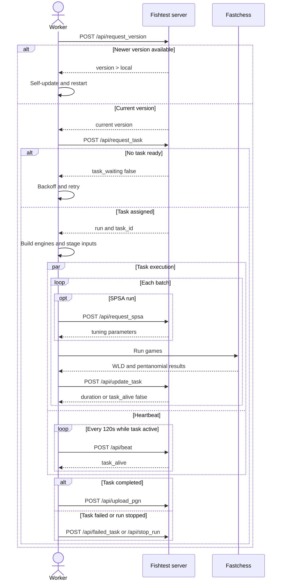

# API Reference

## Protocol invariants

These invariants apply to every worker API endpoint:

- Every response is a JSON object.
- Authenticated endpoints include a `duration` field (float, seconds elapsed
  server-side).
- Application errors return **HTTP 200** with `{"error": "...", "duration": N}`.
- Transport/validation errors return non-200 with a JSON error payload that
  also includes `duration`.
- Content-Type is always `application/json`.
- The current worker protocol version is defined by `WORKER_VERSION` in
  `api.py`.

## Authentication

Workers authenticate via `username` and `password` fields in the
`worker_info` section of every POST body. Credentials are validated against
`UserDb.authenticate()`.

- Invalid credentials -> HTTP 401 + `{"error": "..."}`.
- Missing or malformed JSON -> HTTP 400 + `{"error": "..."}`.

## Protocol lifecycle

A worker's interaction with the server follows this sequence:



1. **Version check** -- `POST /api/request_version`. If the server returns
   a newer version, the worker self-updates and restarts.
2. **Task request** -- `POST /api/request_task`. The server assigns a task
   or returns `{"task_waiting": false}`. The worker retries after a delay.
3. **Engine build** -- The worker compiles Stockfish from source (cached
   by SHA + compiler + environment hash).
4. **Game execution** -- The worker launches fastchess and streams results.
   For SPSA runs, `POST /api/request_spsa` fetches tuning parameters
   before each batch.
5. **Progress reporting** -- `POST /api/update_task` sends partial results
   after each batch. The server returns `task_alive: false` to signal early
   stop.
6. **Heartbeat** -- A daemon thread sends `POST /api/beat` every 120s.
   The server uses missed heartbeats to detect dead workers and reassign
   tasks.
7. **Completion** -- Final `POST /api/update_task` reports the completed
   task. `POST /api/upload_pgn` sends compressed game data. On failure,
   `POST /api/failed_task` reports the error.
8. **Loop** -- The worker returns to step 2.

`POST /api/stop_run` and `POST /api/worker_log` are called on demand
outside the main loop.

## Worker API paths

The following 9 endpoints are considered **worker API paths**. On non-primary
instances, these return HTTP 503 (except `/api/upload_pgn`, which is routed
to a dedicated backend):

```
/api/request_version
/api/request_task
/api/update_task
/api/beat
/api/request_spsa
/api/failed_task
/api/stop_run
/api/upload_pgn
/api/worker_log
```

## Authenticated endpoints

### POST /api/request_version

**Purpose**: Returns the current worker protocol version. Workers call this
to check if they need to upgrade.

**Request body**:
```json
{
  "password": "string",
  "worker_info": { "username": "string" }
}
```

**Response**:
```json
{ "version": 331, "duration": 0.001 }
```

---

### POST /api/request_task

**Purpose**: Requests a testing task assignment from the server.

**Request body**:
```json
{
  "password": "string",
  "worker_info": {
    "username": "string",
    "unique_key": "string",
    "concurrency": 4,
    ...system specs...
  }
}
```

**Success response**:
```json
{
  "run": {
    "_id": "run_id",
    "args": { ...run arguments... },
    "my_task": { "num_games": 200, "start": 0 }
  },
  "task_id": 0,
  "duration": 0.05
}
```

**No work available**:
```json
{ "task_waiting": false, "duration": 0.01 }
```

---

### POST /api/update_task

**Purpose**: Reports partial or final game results for an assigned task.

**Request body**:
```json
{
  "password": "string",
  "worker_info": { "username": "string", "unique_key": "string" },
  "run_id": "string",
  "task_id": 0,
  "stats": { "wins": 10, "losses": 5, "draws": 15, "pentanomial": [0, 2, 8, 2, 0] }
}
```

**Response**:
```json
{ "duration": 0.02 }
```

---

### POST /api/beat

**Purpose**: Heartbeat -- keeps the task lease alive. Workers send this
periodically to prevent the server from reclaiming the task.

**Request body**:
```json
{
  "password": "string",
  "worker_info": { "username": "string", "unique_key": "string" },
  "run_id": "string",
  "task_id": 0
}
```

**Response**:
```json
{ "task_alive": true, "duration": 0.001 }
```

---

### POST /api/request_spsa

**Purpose**: Requests SPSA tuning parameters for the current iteration.

**Request body**:
```json
{
  "password": "string",
  "worker_info": { "username": "string", "unique_key": "string" },
  "run_id": "string",
  "task_id": 0
}
```

**Response**:
```json
{
  "w_params": [...],
  "b_params": [...],
  "duration": 0.01
}
```

---

### POST /api/failed_task

**Purpose**: Marks a task as failed (worker-side crash, timeout, or error).

**Request body**:
```json
{
  "password": "string",
  "worker_info": { "username": "string", "unique_key": "string" },
  "run_id": "string",
  "task_id": 0,
  "message": "optional error description"
}
```

**Response**:
```json
{ "duration": 0.01 }
```

---

### POST /api/stop_run

**Purpose**: Requests early termination of a run (e.g., SPRT bounds reached).
Requires the user to have at least 1000 CPU hours.

**Request body**:
```json
{
  "password": "string",
  "worker_info": { "username": "string", "unique_key": "string" },
  "run_id": "string",
  "task_id": 0,
  "message": "optional reason"
}
```

**Response**:
```json
{ "duration": 0.01 }
```

---

### POST /api/upload_pgn

**Purpose**: Uploads gzip-compressed PGN game records for a completed task.

**Request body**:
```json
{
  "password": "string",
  "worker_info": { "username": "string", "unique_key": "string" },
  "run_id": "string",
  "task_id": 0,
  "pgn": "base64-encoded gzip data"
}
```

**Response**:
```json
{ "duration": 0.05 }
```

**Note**: This endpoint is routed to a non-primary backend (port 8003) for
single-instance handling. It is excluded from `PRIMARY_ONLY_WORKER_API_PATHS`.

---

### POST /api/worker_log

**Purpose**: Logs a worker-side diagnostic message on the server's action log.

If `run_id` is provided, `task_id` must also be provided so the server can
verify that the reporting worker is actually assigned to that task.

**Request body**:
```json
{
  "password": "string",
  "worker_info": { "username": "string", "unique_key": "string" },
  "message": "log message string",
  "run_id": "optional run id when paired with task_id",
  "task_id": 0
}
```

**Response**:
```json
{ "duration": 0.001 }
```

## Browser cross-origin policy

Endpoint-specific CORS preflight handlers are not part of the public API
contract.

## Read-only endpoints

These endpoints take no worker credentials. They serve data to the web UI,
external tools, and API consumers.

Some requests need a login: the session cookie from `POST /login`, or an API
token. Without one, they return HTTP 401 before any run is read, with a JSON
error payload, a `WWW-Authenticate: Bearer` header, and `Cache-Control:
no-store`. The session of a blocked or removed user counts as no login. An
answer that needed a login also carries `Cache-Control: no-store`.

| Endpoint | Without a login |
|----------|-----------------|
| `GET /api/active_runs` | Served |
| `GET /api/finished_runs` | Served for page 1, or with a recent `timestamp` |
| `POST /api/actions` | Served for the run-scoped filters below |
| `GET /api/get_run/{id}` | Served for a recent run |
| `GET /api/get_elo/{id}` | Served for a recent run |
| `GET /api/get_task/{id}/{task_id}` | HTTP 401 |
| `GET /api/calc_elo` | Served |
| `GET /api/nn/{id}` | Served |
| `GET /api/pgn/{id}` | Served |
| `GET /api/run_pgns/{id}` | Served |
| `GET /api/rate_limit` | Served |

A run is recent when its ID was created within the last
`ANONYMOUS_RUN_MAX_AGE_DAYS` days (`http/settings.py`). The age comes from the
ObjectId, whether or not the run has finished.

### API tokens

A script identifies its user with an API token in the `Authorization` header:

```bash
curl -H "Authorization: Bearer $FISHTEST_TOKEN" \
  "https://tests.stockfishchess.org/api/get_task/$RUN_ID/0"
```

- A user creates, replaces, and revokes their token on the `/user` page. Each
  user has one token.
- The page shows a new token once. The server stores only its SHA-256 hash.
- A token stops working `API_TOKEN_MAX_AGE_DAYS` days after it was created
  (`http/settings.py`). Replacing it starts a new period.
- Changing the password, being blocked or unblocked, and removal of the account
  revoke the token, so a user is never unblocked with a working one. A blocked or
  pending user cannot create a token.
- A token whose user is blocked or removed in the database, outside the app, is
  deleted the next time it is used.
- Only the endpoints in this section accept a token. Web pages and worker
  endpoints do not.
- A token in a query string is ignored.
- An unknown, expired, or revoked token, or the token of a blocked or pending
  user, counts as no credential: public requests are served and the rest return
  HTTP 401 with `WWW-Authenticate: Bearer error="invalid_token"`.
- Browser pages on other origins cannot send the header, because these endpoints
  answer no preflight request.

### GET /api/active_runs

Returns all unfinished runs as a JSON object keyed by run ID. Tasks and
heavy fields are excluded from the projection. The feed can lag by a few
seconds.

### GET /api/finished_runs

Returns paginated finished runs. Query parameters:

| Parameter | Type | Description |
|-----------|------|-------------|
| `page` | int (required) | Page number (1-based) |
| `username` | string | Filter by submitter |
| `success_only` | bool | Only successful runs |
| `yellow_only` | bool | Only inconclusive runs |
| `ltc_only` | bool | Only long time control runs |
| `timestamp` | string | UNIX timestamp filter |

Without a login, a page after the first needs a `timestamp` within the last
`ANONYMOUS_RUN_MAX_AGE_DAYS` days.

### POST /api/actions

Returns up to 200 actions matching the JSON query body, newest first. A body
longer than `ACTIONS_BODY_MAX` bytes (`api.py`) returns HTTP 413. A filter that
runs longer than `ACTIONS_QUERY_MAX_MS` returns HTTP 503.

With a login the body is a filter on the fields `action`, `username`, `worker`,
`run_id`, `run`, `task_id`, `time`, `message`, `nn`, and `user`. A field takes a
constant or the comparisons `$eq`, `$ne`, `$gt`, `$gte`, `$lt`, `$lte`, `$in`,
and `$nin`. `$and`, `$or`, and `$nor` combine filters. Anything else returns
HTTP 400.

Without a login the body must select runs, and may contain only these keys.
Any other body returns HTTP 401. The actions of an old run are left out of the
answer.

| Key | Value |
|-----|-------|
| `run_id` (required) | A run ID, or `{"$in": [run IDs]}` with at most `ANONYMOUS_ACTIONS_RUN_IDS_MAX` IDs (`schemas.py`) |
| `action` | `finished_run`, `stop_run`, `delete_run`, or `new_run`, or `{"$in": [those names]}` |
| `time` | `{"$gte": number}` |

### GET /api/get_run/{id}

Returns a single run document with `tasks`, `bad_tasks`, and
`args.spsa.param_history` emptied. `GET /api/get_task/{id}/{task_id}` returns a
task.

### GET /api/get_task/{id}/{task_id}

Returns a single task document. The `unique_key` is truncated and
`remote_addr` is masked for privacy.

### GET /api/get_elo/{id}

Returns `{}` for a run without SPRT. For an SPRT run, returns the run document
as `GET /api/get_run/{id}` shapes it, with an added `elo` object.

### GET /api/calc_elo

Computes ELO from provided W/D/L or pentanomial counts. Query parameters:

| Parameter | Type | Description |
|-----------|------|-------------|
| `W`, `D`, `L` | int | Win/Draw/Loss counts (trinomial) |
| `LL`, `LD`, `DDWL`, `WD`, `WW` | int | Pentanomial counts |
| `elo0`, `elo1` | float | SPRT bounds (optional) |
| `elo_model` | string | `BayesElo`, `logistic`, or `normalized` |

### GET /api/nn/{id}

Redirects to the neural network download URL (`FISHTEST_NN_URL`). Increments
the download counter.

### GET /api/pgn/{id}

Downloads a gzip-compressed PGN file for a specific run/task. Returns a
`StreamingResponse` with `Content-Encoding: gzip`.

### GET /api/run_pgns/{id}

Downloads all PGN files for a run as a single gzip archive. Filename must
match `{run_id}.pgn.gz`.

### GET /api/rate_limit

Returns GitHub API rate limit information.

## Validation

Request bodies are validated against vtjson schemas defined in `schemas.py`:

- `api_access_schema` -- validates the authentication fields (`username`,
  `password`, `worker_info`).
- `api_schema` -- validates the full request body structure for worker
  endpoints.
- `gzip_data` -- validates that uploaded PGN data is valid gzip.
- `action_query_schema` -- validates the `POST /api/actions` body of a request
  with a login.
- `anonymous_actions_query_schema` -- validates the `POST /api/actions` body
  of a request without a login.

Schema validation failures produce HTTP 400 responses, except that a
`POST /api/actions` body failing `anonymous_actions_query_schema` returns HTTP
401 without a login.

## Error shape

Errors raised through `GenericApi.handle_error()`, on worker and read-only
endpoints, follow this shape:

```json
{
  "error": "/api/endpoint_path: error message",
  "duration": 0.001
}
```

The error string is prefixed with the endpoint path for client-side
disambiguation.

## Adding a new API endpoint

1. Add the route in `api.py` with `@router.post(...)` or `@router.get(...)`.
2. Write the handler as an `async def` that constructs the appropriate
   `WorkerApi` or `UserApi` shim and offloads the handler body via
   `run_in_threadpool`.
3. Return a dict containing `"duration"` (use `GenericApi.add_time()`).
4. For application errors, use `GenericApi.handle_error()` which raises
   `HTTPException` with a dict detail payload.
5. Add a vtjson schema in `schemas.py` if the endpoint accepts structured
   input.
6. Add a contract test in `tests/test_api.py`.
7. If the endpoint requires worker authentication, add its path to
   `WORKER_API_PATHS` in `api.py`.
8. If a scraper can make a read endpoint costly, call `UserApi.require_login()`
   or `require_login_for_old_run()` before reading any run, and add the endpoint
   to the table under "Read-only endpoints".
